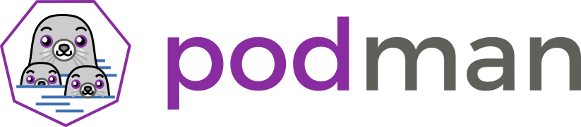
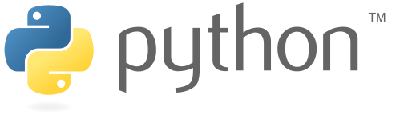
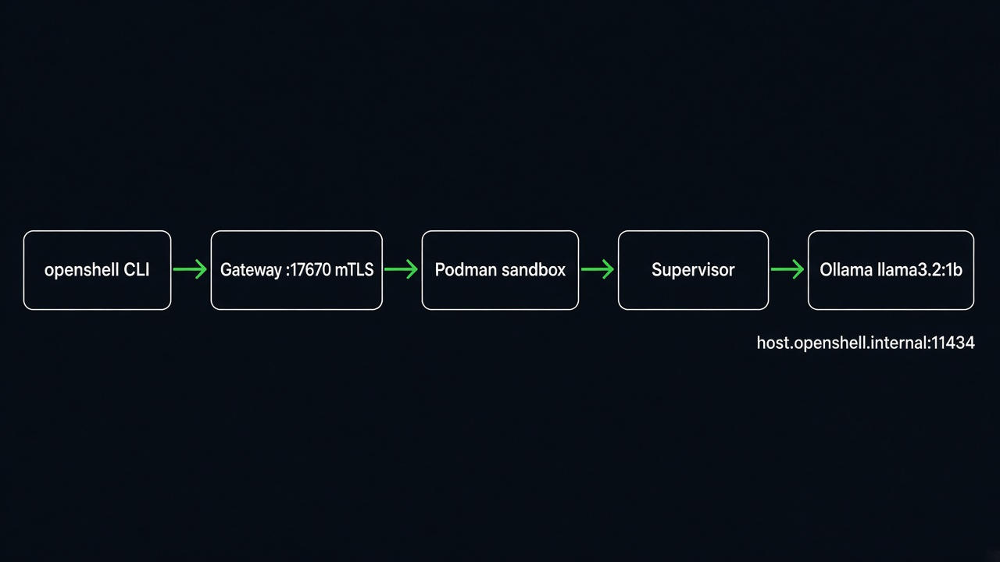
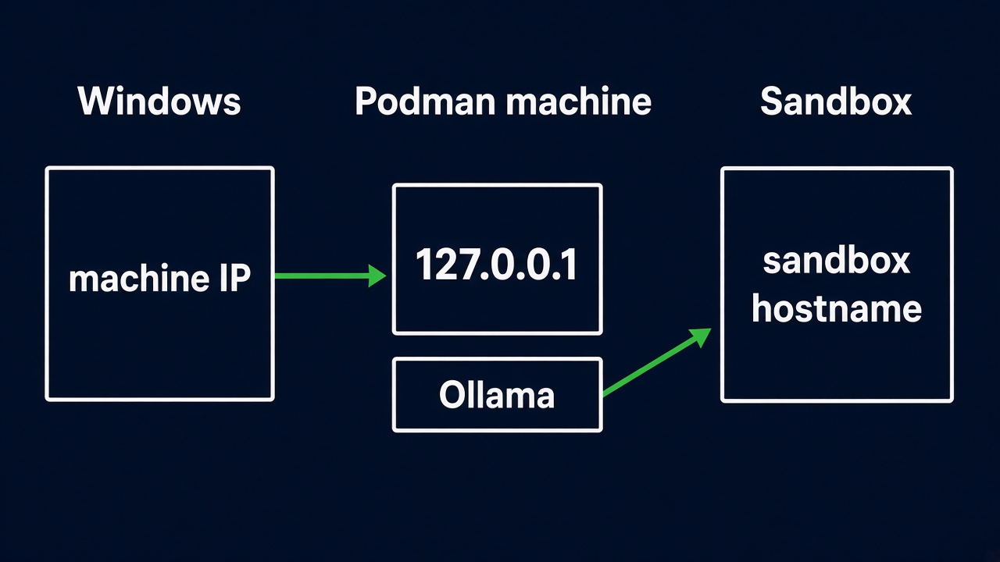
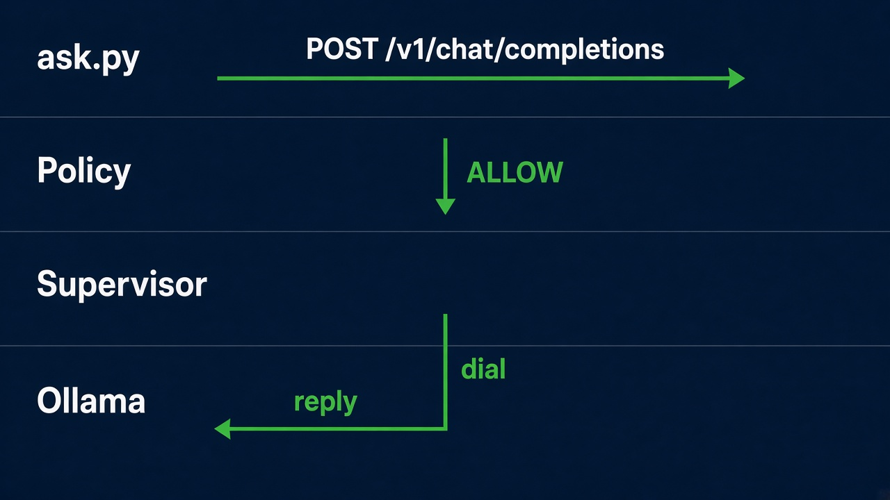
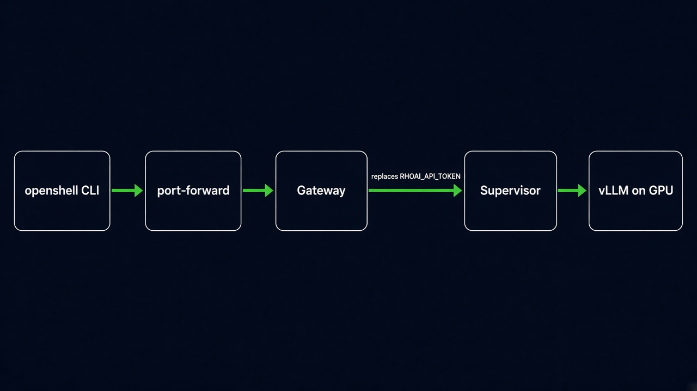

[](https://workspaces.openshift.com/#https://github.com/maximilianoPizarro/hello-openshell?storageType=ephemeral)

<p>
  <a href="https://docs.nvidia.com/openshell/">NVIDIA OpenShell</a>
  &nbsp;
  <a href="https://podman.io/"></a>
  &nbsp;
  <a href="https://www.python.org/"></a>
</p>

# OpenShell with a small model

This repository walks the same client, [examples/ask.py](examples/ask.py), through three places:

| Track | Where it runs | What serves the model |
| --- | --- | --- |
| Local | Podman on your machine | Ollama `llama3.2:1b`, 3 GiB cap |
| Developer Sandbox | OpenShift Dev Spaces | Shared Granite already on the sandbox |
| OpenShift AI | A cluster you administer | Granite 3.3 2B on one NVIDIA GPU |

The local track was run on this machine on 11 November 2026. The step-by-step site is in [docs/](docs/index.html) (English and Spanish). The cluster write-up is [docs/openshift-ai.md](docs/openshift-ai.md).



## Tested on this machine

Windows 11, Podman 6.1.4, machine `podman-machine-default`:

- Fedora 44 on WSL2, kernel `6.18.58.1-microsoft-standard-WSL2`, cgroup v2, about 15 GiB RAM. Start it with `podman machine start`. `podman machine set --memory` does not apply to WSL machines; RAM is set in `%USERPROFILE%\.wslconfig`.
- The default connection is rootful, `podman-machine-default-root`, socket `/run/podman/podman.sock`.
- `podman compose` delegates to Docker Compose 5.3.1.
- The `openshell` CLI is not on the Windows PATH. The gateway runs inside the machine. `podman machine ssh` logs in as root, and the user unit came up on that session.
- Ollama 0.40.16 listens on port `11434` inside the machine. With WSL NAT (`networkingMode=nat`), Windows reaches it on the machine `eth0` IPv4. In this run that address was `172.21.235.119`. Inside the machine, `127.0.0.1:11434` answers.
- `llama3.2:1b` (about 1.3 GB) answered `Hola.` With the model loaded, `podman stats` showed 3.19 GiB of 3.22 GiB.
- OpenShell RPMs `0.1.8-1.fc44` (`openshell`, `openshell-gateway`, `openshell-prover`). `openshell status` connected to `https://127.0.0.1:17670`. `socket_path = "/run/podman/podman.sock"` was added under `[openshell.drivers.podman]`.
- Sandbox `model-check` on `registry.access.redhat.com/hi/python:3.12` listed `llama3.2:1b` through `host.openshell.internal:11434`. `ask.py` in that image returned a Spanish sentence. Python in the image is `/usr/bin/python3.12` (3.12.16). The policy [deploy/hi-python.policy.yaml](deploy/hi-python.policy.yaml) sets UID and GID `65532`.

The Llama Stack starter image (`docker.io/ogxai/distribution-starter`, about 3.4 GB compressed) is not part of this path. `docker.io/ogx/distribution-starter` is denied by the registry, and the real image saturated this machine.

## Versions

| Piece | Version |
| --- | --- |
| OpenShell CLI and gateway | 0.1.8 |
| Driver | `podman` |
| Podman on Windows | 6.1.4, Fedora 44 machine |
| Ollama | `docker.io/ollama/ollama:latest` (this run: 0.40.16), 3 GiB and 2 CPUs |
| Model | `llama3.2:1b` |
| API inside the machine | `http://127.0.0.1:11434/v1` |
| API from Windows | `http://<eth0-ipv4>:11434/v1` |
| Sandbox image | `registry.access.redhat.com/hi/python:3.12` |

## Before you start

```bash
podman machine start
podman version
podman info --format '{{json .Host}}' | findstr cgroupVersion
```

Inside the machine, `cgroupVersion` must be `v2`.

## 1. Start Ollama

From the repository root:

```bash
podman compose -f deploy/compose.yaml up -d
```

The same container by hand:

```bash
podman volume create ollama
podman run -d --name ollama --replace \
  -p 11434:11434 \
  --memory 3g --cpus 2 \
  -e OLLAMA_MAX_LOADED_MODELS=1 \
  -e OLLAMA_NUM_PARALLEL=1 \
  -e OLLAMA_KEEP_ALIVE=5m \
  -v ollama:/root/.ollama \
  docker.io/ollama/ollama:latest
```

Pull the 1B model once (about 1.3 GB). From Windows Git Bash the API is on the machine IPv4. `MSYS_NO_PATHCONV=1` stops Git from rewriting the `ssh` path:

```bash
OLLAMA_IP=$(MSYS_NO_PATHCONV=1 podman machine ssh "ip -4 -o addr show eth0" | awk '{print $4}' | cut -d/ -f1 | head -1)
echo "$OLLAMA_IP"

until curl -fsS "http://${OLLAMA_IP}:11434/api/tags" >/dev/null; do
  sleep 2
done

podman exec ollama ollama pull llama3.2:1b

curl -sS "http://${OLLAMA_IP}:11434/v1/models" \
  -H 'Authorization: Bearer fake'
```

Inside the machine the same check uses `http://127.0.0.1:11434`. An OpenShell sandbox uses `host.openshell.internal:11434`. OpenShell blocks loopback. The model id must be `llama3.2:1b`.



Windows uses the machine IPv4. Inside the machine, `127.0.0.1:11434`. The sandbox uses the name `host.openshell.internal`.

```bash
podman stats --no-stream ollama
```

## 2. Install OpenShell with the Podman driver

On Windows, install inside the machine:

```bash
podman machine ssh
```

That shell is root on this machine. Containers created by the Windows `podman` client are on `/run/podman/podman.sock`. A user socket also exists at `/run/user/1000/podman/podman.sock` and does not see those containers.

```bash
curl -LsSf https://raw.githubusercontent.com/NVIDIA/OpenShell/v0.1.8/install.sh | \
  OPENSHELL_VERSION=v0.1.8 sh
```

The Fedora installer listens on `https://127.0.0.1:17670` and already sets `compute_driver = "podman"`. Add the socket the Windows client uses, under `[openshell.drivers.podman]` in `~/.config/openshell/gateway.toml`:

```toml
socket_path = "/run/podman/podman.sock"
```

Check it and restart:

```bash
openshell-gateway config preflight --path ~/.config/openshell/gateway.toml
systemctl --user restart openshell-gateway
openshell gateway add https://127.0.0.1:17670 --local --name openshell
openshell gateway select openshell
openshell status
```

`openshell status` should say Connected, version 0.1.8. If the user service is missing, `systemctl status openshell-gateway` and `journalctl -u openshell-gateway -f` show whether the system bus has the unit instead.

## 3. Import the profile

[deploy/ollama.profile.yaml](deploy/ollama.profile.yaml) allows only `host.openshell.internal:11434`. It stores no key. Ollama accepts `fake`, and that string opens no other host.

From the repository root inside the machine (this machine mounts the Windows tree at `/mnt/c/Users/Max/hello-openshell`):

```bash
openshell profile lint -f deploy/ollama.profile.yaml
openshell profile import -f deploy/ollama.profile.yaml
openshell provider create --name ollama --type ollama
openshell provider get ollama
```

## 4. First sandbox

The sandbox image is the [Red Hat Hardened Image for Python 3.12](https://catalog.redhat.com/en/software/containers/hi/python/69c576bbbea7c4011384c57a), `registry.access.redhat.com/hi/python:3.12`. The interpreter is `/usr/bin/python3.12`. That image runs as UID `65532`, and the account's primary group in `/etc/passwd` is `0`. OpenShell rejects group `0`, so [deploy/hi-python.policy.yaml](deploy/hi-python.policy.yaml) sets `run_as_user` and `run_as_group` to `65532`.

```bash
export MODEL_NAME=llama3.2:1b

openshell sandbox create \
  --name model-check \
  --from registry.access.redhat.com/hi/python:3.12 \
  --provider ollama \
  --policy deploy/hi-python.policy.yaml \
  -- /usr/bin/python3.12 -c 'import urllib.request; print(urllib.request.urlopen(urllib.request.Request("http://host.openshell.internal:11434/v1/models", headers={"Authorization":"Bearer fake"})).read().decode())'
```

The body is the same JSON the host returned. A log line `resolves to always-blocked address` means the URL used `127.0.0.1` or `localhost`.

## 5. An agent that calls the model

[examples/ask.py](examples/ask.py) reads `OPENAI_BASE_URL` and `MODEL_NAME`. It sends `Authorization: Bearer` with `RHOAI_API_TOKEN`, then `OPENAI_API_KEY`, then the literal `fake`.

```bash
openshell sandbox create \
  --name hello-agent \
  --from registry.access.redhat.com/hi/python:3.12 \
  --provider ollama \
  --policy deploy/hi-python.policy.yaml \
  --env OPENAI_BASE_URL=http://host.openshell.internal:11434/v1 \
  --env "MODEL_NAME=${MODEL_NAME}" \
  --env OPENAI_API_KEY=fake \
  -- /usr/bin/python3.12 -c "$(cat examples/ask.py)"
```

`$(cat examples/ask.py)` expands in the shell at the repository root. OpenShell warns that `OPENAI_API_KEY` is visible to the process. Here the value is `fake`. On this machine the sandbox printed a sentence from the model and the policy log stayed on `ALLOWED`.



```bash
openshell policy get hello-agent --full
openshell logs hello-agent
podman stats --no-stream ollama
```

## Developer Sandbox

Open this repository in [OpenShift Dev Spaces](https://docs.redhat.com/en/documentation/red_hat_openshift_dev_spaces/3.28/html/user_guide/assembly_getting-started_user_guide) on the [Developer Sandbox](https://developers.redhat.com/developer-sandbox) with the button at the top, or paste the repository URL into **Create Workspace**. [devfile.yaml](devfile.yaml) installs the OpenShell 0.1.8 CLI when the workspace starts (`scripts/install-openshell-cli.sh`, the static musl binary, into `~/.local/bin`). A failed install no longer stops the workspace. Other tasks wait until you choose them (**Terminal → Run Task…**).

Checked on 11 November 2026 against `https://api.rm2.thpm.p1.openshiftapps.com:6443` as `maximilianopizarro5`, project `maximilianopizarro5-dev`, OpenShift 4.22.22:

- The user cannot create CRDs, namespaces, or ClusterRoles.
- `agents.x-k8s.io` is not served, so the Helm chart 0.1.8 preflight refuses to install the gateway.
- GPU quota for the project is 0.
- `oc get inferenceservice -n sandbox-shared-models` returned no objects.

The gateway was not installed. `openshell version` works after the CLI install. `openshell status` needs a gateway, which this project cannot host.

| Task | What it runs |
| --- | --- |
| Install OpenShell CLI | `scripts/install-openshell-cli.sh` (also on workspace start) |
| OpenShell version | the same install, then `openshell version` |
| Project status | `scripts/sandbox-status.sh` |
| Ask Granite | `scripts/sandbox-ask.sh curl` |
| Ask with ask.py | `scripts/sandbox-ask.sh python` |
| Clean | deletes objects labeled `app.kubernetes.io/part-of=hello-openshell` |

Details, in both languages: [docs/sandbox/index.html](docs/sandbox/index.html).

## OpenShift AI

The admin path (OpenShift 4.19+, Agent Sandbox v1.0.10, Helm chart 0.1.8, vLLM chart 0.7.1, Granite 3.3 2B) is [docs/openshift-ai.md](docs/openshift-ai.md), with [deploy/granite-2b-values.yaml](deploy/granite-2b-values.yaml) and [deploy/rhoai-granite.profile.yaml](deploy/rhoai-granite.profile.yaml). It was not applied from this machine.



## When something fails

| What you see | Where to look |
| --- | --- |
| `podman` cannot connect | `podman machine start`. On Windows the socket is absent while the machine is stopped. |
| The Ollama container is killed for memory | `podman stats ollama`. Raise `mem_limit` in [deploy/compose.yaml](deploy/compose.yaml) to `4g` and recreate the container. Stay on `llama3.2:1b` when RAM is tight. |
| `/v1/models` has no `llama3.2:1b` | `podman exec ollama ollama pull llama3.2:1b` is still running. `podman logs ollama`. |
| `curl` to `127.0.0.1:11434` from Windows returns connection refused | Use `OLLAMA_IP` from step 1. Inside the machine, `127.0.0.1:11434` answers. |
| The gateway creates no containers | `socket_path` must be the daemon `podman ps` uses from Windows. Here that is `/run/podman/podman.sock`. |
| The sandbox exits and the log names Landlock or seccomp | The machine kernel refused the filter. OpenShell 0.1.8 does not start the sandbox without that check. |
| `no matching policy` names a binary | On the hardened image the interpreter is `/usr/bin/python3.12`. Add that path, keep `resource_version`, and run `openshell profile update`. |
| `configure an explicit workload group` | The image user `65532` has primary group `0`. Pass `--policy deploy/hi-python.policy.yaml`. |
| `resolves to always-blocked address` | The sandbox URL uses loopback. Use `host.openshell.internal`. |

To update a profile that is already imported:

```bash
openshell profile export ollama -o yaml > /tmp/ollama.profile.yaml
openshell profile update ollama -f /tmp/ollama.profile.yaml
```

## Tear down

```bash
openshell sandbox delete hello-agent model-check
openshell provider delete ollama
openshell profile delete ollama

podman compose -f deploy/compose.yaml down -v
```

`down -v` removes the compose volume. With this file the volume name is `deploy_ollama`. If you created the container by hand with the volume `ollama`:

```bash
podman rm -f ollama
podman volume rm ollama
```

`podman machine stop` releases the WSL RAM when you are done.

## Pages

The site in [docs/](docs/index.html) is plain HTML. [.github/workflows/gh-pages.yml](.github/workflows/gh-pages.yml) publishes that folder when the repository is pushed to `main` or `master`. This directory is not a git repository yet, so the workflow has not been run.

## References

- [OpenShell installation](https://docs.nvidia.com/openshell/latest/about/installation) and [sandbox runtimes](https://docs.nvidia.com/openshell/latest/how-it-works/sandboxes/runtimes)
- [Inference](https://docs.nvidia.com/openshell/how-it-works/inference)
- [Ollama OpenAI API](https://github.com/ollama/ollama/blob/main/docs/openai.md)
- [Podman](https://podman.io/) and [podman machine](https://docs.podman.io/en/latest/markdown/podman-machine.1.html)
- [Python](https://www.python.org/)
- [OpenShift AI module](docs/openshift-ai.md)

## Trademarks

NVIDIA and OpenShell are trademarks of NVIDIA Corporation. This is an independent guide. The NVIDIA logo file is not included; the name links to the product documentation.

The Podman logo in `docs/assets/logos/podman-logo.png` is the project logo from [podman-container-tools/podman](https://github.com/podman-container-tools/podman/tree/main/logo). Podman is a trademark of Red Hat, Inc.

The Python logo in `docs/assets/logos/python-logo.svg` is the official logo from [python.org/community/logos](https://www.python.org/community/logos/). Python and the Python logo are trademarks of the Python Software Foundation. Use here names the sandbox image. It does not imply PSF endorsement.

Red Hat, OpenShift, and OpenShift Dev Spaces are trademarks of Red Hat, Inc. Those logo files are not included.
