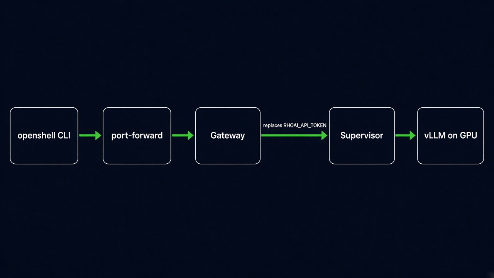

# OpenShell on OpenShift AI

This is the cluster deployment. The machine path, with Podman and Ollama, is the [README](../README.md). The same steps are on the site in [English](openshift/index.html) and [Spanish](es/openshift/index.html).

The guide puts an agent inside an [NVIDIA OpenShell](https://docs.nvidia.com/openshell/) sandbox on an OpenShift cluster, talking to a small model served by Red Hat OpenShift AI on one NVIDIA GPU.

When you finish you have:

- **Granite 3.3 2B Instruct** served by vLLM, on a single GPU, inside OpenShift AI.
- The **OpenShell gateway** in the cluster, without the `privileged` SCC.
- A **sandbox** that can call only that model. The model token lives in the gateway. The agent process sees a placeholder.

OpenShell is NVIDIA's runtime for autonomous agents. The agent runs in an isolated Pod. A supervisor, outside that isolation, opens the connections the policy allows. Landlock trims the filesystem, seccomp trims syscalls, and a `NetworkPolicy` stops the agent Pod from reaching the network on its own. This guide follows the stable path documented for **OpenShell 0.1.8**. Older releases used `openshell inference set` and, on OpenShift, sometimes the `privileged` SCC. That path does not match this version.



The agent does not pick a hidden destination. It calls the internal Service URL. The supervisor compares that call with the `rhoai-granite` profile and only then puts the real token in the `Authorization` header.

## Versions in this guide

| Piece | Version |
| --- | --- |
| OpenShift | 4.19 or later |
| Red Hat OpenShift AI | 3.x, self-managed, KServe in single-model mode |
| OpenShell CLI and Helm chart | 0.1.8 |
| Chart `vllm-kserve` | 0.7.1, repository `redhat-ai-services` |
| Model | `granite-3.3-2b-instruct` |
| Model image | `quay.io/redhat-ai-services/modelcar-catalog:granite-3.3-2b-instruct` |
| GPU | 1 NVIDIA, 16 GiB recommended, 8 GiB minimum |

OpenShift 4.16, 4.17, and 4.18 do not work for this deployment. The RHCOS kernel in those versions was built without Landlock, and OpenShell aborts the sandbox when the Landlock check fails. The CNI must enforce ingress and egress `NetworkPolicy`. OVN-Kubernetes, the default OpenShift CNI, does.

Granite 3.3 2B fits a small GPU and is enough to try tool calling (`--tool-call-parser=granite`). For a daily coding agent, the same chart can serve `granite-3.3-8b-instruct` when the GPU has memory to spare. The OpenShell wiring stays the same: the modelcar URI, the model name, and, if needed, `--max-model-len` change.

This module was not applied from the machine where the local path was tested. There was no cluster in that session.

## What has to exist first

Run the commands from Linux, macOS, or WSL2. The OpenShell CLI installer publishes packages for Linux and macOS. `oc` and `helm` must see the same kubeconfig you will use for the port-forward.

- `oc` logged in with permission to create namespaces, install a chart, and apply the cluster-scoped Agent Sandbox manifest. In practice, a `cluster-admin`.
- Helm 3.
- OpenShift AI installed, with the single-model serving platform enabled. Operator install is in [Configuring your model-serving platform](https://docs.redhat.com/en/documentation/red_hat_openshift_ai_self-managed/3.5/html/configuring_your_model-serving_platform/configuring-your-model-serving-platform_rhoai-admin).
- NVIDIA GPU Operator and Node Feature Discovery, and the GPUs visible to OpenShift AI. NVIDIA's guide is [Install the GPU Operator on OpenShift](https://docs.nvidia.com/datacenter/cloud-native/gpu-operator/latest/openshift/install-gpu-operator.html).
- The cluster can pull from `registry.redhat.io` (the chart's `rhaii/vllm-cuda-rhel9` runtime), `quay.io`, and `registry.access.redhat.com`.

Check the cluster floor:

```bash
oc whoami
oc get clusterversion
oc get datasciencecluster -A
oc get nodes -o custom-columns=NAME:.metadata.name,GPU:.status.allocatable.nvidia\\.com/gpu
oc api-resources | grep -i hardwareprofile
oc get hardwareprofile -n redhat-ods-applications
```

The last command must list an NVIDIA hardware profile. [deploy/granite-2b-values.yaml](../deploy/granite-2b-values.yaml) uses the name `nvidia-gpu-serving` in the namespace `redhat-ods-applications`, the chart default. If your cluster names it differently, change `hardwareProfile.name` before you install.

If `GPU` is empty, the GPU Operator has not published `nvidia.com/gpu` yet. Stop there. vLLM will not start the model.

A [Developer Sandbox](https://developers.redhat.com/developer-sandbox) project is not this module. On 11 November 2026 the project `maximilianopizarro5-dev` on OpenShift 4.22.22 could not create CRDs, namespaces, or ClusterRoles, `agents.x-k8s.io` was not served, and the project GPU quota was 0. The Helm chart stops in that case. The [Dev Spaces workspace](sandbox/index.html) installs the OpenShell CLI only.

## 1. Serve the small model

The [vllm-kserve](https://github.com/redhat-ai-services/helm-charts/tree/main/charts/vllm-kserve) chart creates a `ServingRuntime` and an `InferenceService` in `RawDeployment` mode. The Pod listens on port 8080. KServe publishes a Service in front of it. The model stays loaded on the GPU, with no scale-to-zero, so the agent's first question does not wait for a cold start.

```bash
helm repo add redhat-ai-services https://redhat-ai-services.github.io/helm-charts
helm repo update
helm search repo redhat-ai-services/vllm-kserve --versions
```

If `0.7.1` is missing, use the highest 0.7.x and read `helm show values redhat-ai-services/vllm-kserve --version <version>` before you install. Do not inherit an old `image.tag` or another cluster's `hardwareProfile` without looking.

```bash
oc create namespace rhoai-models

helm upgrade --install granite-2b redhat-ai-services/vllm-kserve \
  --version 0.7.1 \
  --namespace rhoai-models \
  --values deploy/granite-2b-values.yaml \
  --timeout 20m

oc wait -n rhoai-models inferenceservice/granite-2b \
  --for=condition=Ready --timeout=20m
```

The first modelcar pull and the vLLM warm-up can take a long time. If `oc wait` expires and the Pod is still `Running` while it downloads weights, run `oc wait` again. Server logs are in the `kserve-container` container:

```bash
oc logs -n rhoai-models \
  -l serving.kserve.io/inferenceservice=granite-2b \
  -c kserve-container -f
```

The values file asks for a ServiceAccount `granite-client` with a long-lived token Secret, and a Role that can only `get` this `InferenceService`. OpenShift AI uses that permission to authorize inference. Chart 0.7.1 annotates the service with `security.opendatahub.io/enable-auth: "true"` on both template branches, so treat the endpoint as authenticated even when you are not using a Route.

Wait until the controller fills the token and store it in a variable. Do not print it and do not commit it.

```bash
until oc get secret granite-client -n rhoai-models -o jsonpath='{.data.token}' | grep -q .; do
  sleep 5
done

export RHOAI_API_TOKEN="$(
  oc get secret granite-client -n rhoai-models \
    -o jsonpath='{.data.token}' | base64 -d
)"
```

### Find the Service the sandbox will call

```bash
export MODEL_NS=rhoai-models
export MODEL_SVC="$(
  oc get svc -n "$MODEL_NS" \
    -l serving.kserve.io/inferenceservice=granite-2b \
    -o jsonpath='{.items[0].metadata.name}'
)"
export MODEL_CLUSTER_IP="$(
  oc get svc -n "$MODEL_NS" "$MODEL_SVC" -o jsonpath='{.spec.clusterIP}'
)"
export MODEL_PORT="$(
  oc get svc -n "$MODEL_NS" "$MODEL_SVC" -o jsonpath='{.spec.ports[0].port}'
)"
export MODEL_TARGET="$(
  oc get svc -n "$MODEL_NS" "$MODEL_SVC" -o jsonpath='{.spec.ports[0].targetPort}'
)"

if [ "$MODEL_CLUSTER_IP" = "None" ]; then
  export MODEL_PORT="$MODEL_TARGET"
fi

export MODEL_HOST="${MODEL_SVC}.${MODEL_NS}.svc.cluster.local"
echo "${MODEL_HOST}:${MODEL_PORT}"
```

On a normal Service the published port is often `80` and the container listens on `8080`. With a headless Service (`clusterIP: None`), which OpenShift AI 3.x sometimes sets for RawDeployment, DNS returns the Pod IP and you must use the `targetPort` (`8080`). The `if` above keeps the port that actually accepts connections.

Open [deploy/rhoai-granite.profile.yaml](../deploy/rhoai-granite.profile.yaml) and set `host` and `port` to that `MODEL_HOST` and `MODEL_PORT`.

Try the model from any Pod in the cluster before OpenShell is in the path:

```bash
oc run granite-probe -n rhoai-models --rm -i --restart=Never \
  --image=registry.access.redhat.com/ubi9/toolbox:latest \
  --env "RHOAI_API_TOKEN=${RHOAI_API_TOKEN}" -- \
  /usr/bin/bash -lc "curl -sS -m 120 -H \"Authorization: Bearer \${RHOAI_API_TOKEN}\" -H \"Content-Type: application/json\" \"http://${MODEL_HOST}:${MODEL_PORT}/v1/models\""
```

The body must include `granite-3.3-2b-instruct`. A `401` or `403` means the token still cannot see the `InferenceService`. Check that the Secret `granite-client` exists and that the RoleBinding `granite-2b-granite-client-view` points at that ServiceAccount. A timeout means the vLLM Pod is not Ready, or a `NetworkPolicy` in the namespace already selects those Pods and blocks the probe.

## 2. Install Agent Sandbox and the gateway

OpenShell does not create sandbox Pods by itself. It uses the Kubernetes SIG [Agent Sandbox](https://github.com/kubernetes-sigs/agent-sandbox) controller. The OpenShell chart checks that the API exists and does not install it for you.

```bash
oc apply -f https://github.com/kubernetes-sigs/agent-sandbox/releases/download/v1.0.10/sandbox.yaml
oc -n agent-sandbox-system rollout status deployment/agent-sandbox-controller --timeout=180s
```

That manifest is the Agent Sandbox v1.0.10 core, the release current when this guide was written. OpenShell needs the CRD `sandboxes.agents.x-k8s.io` and the controller. The project extensions are a different manifest and this guide does not use them. The `agent-sandbox-controller` Deployment must be `Running`.

Install the gateway with the restricted OpenShift posture. Clearing `fsGroup` and `runAsUser` lets the `restricted-v2` SCC assign the namespace UID. The gateway and the sandboxes run without extra capabilities.

```bash
oc create namespace openshell

helm upgrade --install openshell \
  oci://ghcr.io/nvidia/openshell/helm-chart \
  --version 0.1.8 \
  --namespace openshell \
  --set podSecurityContext.fsGroup=null \
  --set securityContext.runAsUser=null

oc -n openshell rollout status statefulset/openshell --timeout=300s
oc -n openshell get pods,svc,statefulset
```

The chart generates PKI in a Helm hook. The first `helm upgrade --install` creates the Secrets `openshell-server-tls` and `openshell-client-tls`. If the StatefulSet does not appear, look at the hook Job:

```bash
oc get jobs,pods -n openshell
oc describe pod -n openshell -l app.kubernetes.io/name=openshell
```

An `unable to validate against any security context constraint` error on the gateway is fixed by the two `--set` flags above. A Landlock or seccomp user-notification error shows up later, when the first sandbox is created, and means the node is not OpenShift 4.19+ or the node runtime will not install the filter from a process without capabilities.

## 3. Connect the CLI

On WSL, Linux, or macOS:

```bash
curl -LsSf https://raw.githubusercontent.com/NVIDIA/OpenShell/v0.1.8/install.sh | \
  OPENSHELL_VERSION=v0.1.8 sh

openshell version
```

The installer also starts a local gateway on your machine. The one you want is the cluster gateway. Leave the port-forward running in one terminal:

```bash
oc -n openshell port-forward svc/openshell 8080:8080
```

In another terminal, copy the client bundle the chart generated. The directory name must match the gateway name you will register. These files are transport credentials. They stay in your home directory, with user permissions.

```bash
mkdir -p ~/.config/openshell/gateways/openshift/mtls

oc -n openshell get secret openshell-client-tls \
  -o jsonpath='{.data.ca\.crt}' | base64 -d \
  > ~/.config/openshell/gateways/openshift/mtls/ca.crt

oc -n openshell get secret openshell-client-tls \
  -o jsonpath='{.data.tls\.crt}' | base64 -d \
  > ~/.config/openshell/gateways/openshift/mtls/tls.crt

oc -n openshell get secret openshell-client-tls \
  -o jsonpath='{.data.tls\.key}' | base64 -d \
  > ~/.config/openshell/gateways/openshift/mtls/tls.key

chmod 600 ~/.config/openshell/gateways/openshift/mtls/tls.key

openshell gateway add https://127.0.0.1:8080 --local --name openshift
openshell gateway select openshift
openshell status
```

The server certificate includes `localhost` and `127.0.0.1`, so the port-forward verifies the name without extra flags. This access is for a lab. A shared gateway is published with OIDC and end-to-end TLS. The two official options are in [OpenShell on OpenShift](https://docs.nvidia.com/openshell/kubernetes/openshift): Gateway API with `BackendTLSPolicy` on OpenShift 4.22+, or a passthrough Route on any 4.19+.

`export RHOAI_API_TOKEN` must still be set in this terminal. Import the profile and create the provider. The provider stores the token in the gateway. Then clear the variable from your shell.

```bash
openshell profile lint -f deploy/rhoai-granite.profile.yaml
openshell profile import -f deploy/rhoai-granite.profile.yaml

openshell provider create \
  --name rhoai-granite \
  --type rhoai-granite \
  --credential RHOAI_API_TOKEN

unset RHOAI_API_TOKEN
openshell provider get rhoai-granite
```

`provider get` shows the variable name, never the value. `--credential RHOAI_API_TOKEN` without `=` reads the value from your environment.

## 4. First sandbox

This call only lists models. The image is UBI toolbox, which has `curl` at `/usr/bin/curl`, one of the binaries in the profile.

```bash
export MODEL_NAME=granite-3.3-2b-instruct

openshell sandbox create \
  --name model-check \
  --from registry.access.redhat.com/ubi9/toolbox:latest \
  --provider rhoai-granite \
  -- /usr/bin/bash -lc "curl -sS -H \"Authorization: Bearer \${RHOAI_API_TOKEN}\" \"http://${MODEL_HOST}:${MODEL_PORT}/v1/models\""
```

Your shell expands `MODEL_HOST` and `MODEL_PORT` before it sends the command. `\${RHOAI_API_TOKEN}` arrives literally at the sandbox `bash`, and that bash expands the placeholder OpenShell injected into the environment. `curl` is the process that opens the connection. The supervisor swaps the placeholder for the real token only when the host, port, and binary are in the profile. If the policy does not allow the call, the token does not leave the gateway.

The body is the same `/v1/models` JSON the probe returned.

## 5. An agent that calls the model

[examples/ask.py](../examples/ask.py) is a small client. It uses the standard library, sends `RHOAI_API_TOKEN` in `Authorization`, and asks the model for one sentence. If that token is absent it uses `OPENAI_API_KEY` and, last, the literal `fake` from the local lab. The `ubi9/python-312` image has `python3` at `/opt/app-root/bin`, and that path is in the profile.

From the repository root, with the port-forward still up:

```bash
openshell sandbox create \
  --name hello-agent \
  --from registry.access.redhat.com/ubi9/python-312:latest \
  --provider rhoai-granite \
  --env "OPENAI_BASE_URL=http://${MODEL_HOST}:${MODEL_PORT}/v1" \
  --env "MODEL_NAME=${MODEL_NAME}" \
  -- /opt/app-root/bin/python3 -c "$(cat examples/ask.py)"
```

`$(cat examples/ask.py)` expands in your shell, before the command enters the sandbox. The source travels as the `python3 -c` argument. The URL and the model name enter through `--env`, which does reach the sandbox. `RHOAI_API_TOKEN` arrives on its own, from the provider.

The output is a sentence from the model. That closes the path: CLI, gateway, supervisor, vLLM, and GPU.

To keep talking in the same sandbox:

```bash
openshell sandbox connect hello-agent
```

To see what the profile allowed:

```bash
openshell policy get hello-agent --full
openshell sandbox provider list hello-agent
openshell logs hello-agent
```

## 6. Leave the cluster usable by a team

The port-forward and the mTLS bundle are enough for a one-person lab. For a team:

1. Publish the gateway with a passthrough Route or with Gateway API, and configure OIDC. The procedure is in the [OpenShell OpenShift guide](https://docs.nvidia.com/openshell/kubernetes/openshift) and in [Access Control](https://docs.nvidia.com/openshell/how-it-works/gateways/authentication). The chart already has `openshiftRoute.enabled` and `grpcRoute.backendTLSPolicy.enabled`.
2. Store provider tokens in Kubernetes Secrets, with `server.credentialDrivers.kubernetesSecrets.enabled=true`, in a namespace other than the sandbox namespace. [Set Up OpenShell on Kubernetes](https://docs.nvidia.com/openshell/kubernetes/setup) explains it.
3. Widen the profile only with the binaries the agent actually runs. A coding agent such as OpenCode starts from an image that already contains the binary, for example `ghcr.io/anomalyco/opencode:latest`, and the profile must name `/usr/local/bin/opencode`. The official walk-through is [Run Your First Agent](https://docs.nvidia.com/openshell/latest/about/run-your-first-agent). The client chooses the model. OpenShell does not rewrite the model name.
4. When the agent hits a host the policy does not have, the [policy advisor](https://docs.nvidia.com/openshell/latest/how-it-works/policies/advisor) leaves a proposal. Review it with `openshell rule get <sandbox> --status pending` and accept one at a time. Approving the whole set opens more network than the agent needs.
5. If the GPU can take more, change the URI to `oci://quay.io/redhat-ai-services/modelcar-catalog:granite-3.3-8b-instruct`, raise `--max-model-len` carefully, and update `MODEL_NAME`. The tag catalog is [quay.io/redhat-ai-services/modelcar-catalog](https://quay.io/repository/redhat-ai-services/modelcar-catalog?tab=tags).

The same profile does not fit `api.openai.com` or a public NIM. An OpenAI profile binds the secret to that provider's hosts. An in-cluster vLLM needs its own host, its own port, and its own binaries. That split is intentional from OpenShell 0.1.

## When something fails

| What you see | Where to look |
| --- | --- |
| The sandbox dies at start and the log mentions Landlock or seccomp | The node must be OpenShift 4.19 or later, and the runtime must let a process without capabilities install the filter. In 0.1.8 that is the fix. |
| `credential_endpoint_mismatch` | The policy let the call through, but the profile does not authorize the token for that host, port, or path. `openshell profile export rhoai-granite -o yaml` shows the contract. |
| The OCSF log says `no matching policy` or names a binary | The real executable is not in `binaries`. On UBI Python it is often `/opt/app-root/bin/python3` or a `python3.12`. Add the path, keep `resource_version`, and run `openshell profile update rhoai-granite -f <file>`. |
| `resolves to always-blocked address` | The client used `127.0.0.1`, `localhost`, or a link-local IP. Those networks are always blocked. The URL must be the Service DNS. |
| Timeout to the model, and the step 1 probe worked | A `NetworkPolicy` in `rhoai-models` selects the vLLM Pods and does not allow the `openshell` namespace. Add an ingress from `kubernetes.io/metadata.name: openshell` to the container port, and leave the rules that already allow probes and the Route. |
| `401` from the sandbox | The placeholder did not reach the header, or the ServiceAccount can no longer `get` the `InferenceService`. `openshell sandbox provider list hello-agent` must show `rhoai-granite`. A process that was already running does not see new variables: start another command. |
| The vLLM Pod is killed for GPU memory | Lower `--max-model-len` to `2048` in `deploy/granite-2b-values.yaml` and run Helm again. |
| `ImagePullBackOff` for `rhaii/vllm-cuda-rhel9` | The cluster has no entitlement for `registry.redhat.io`. The OpenShift global pull secret must cover that registry. |
| The local gateway answers instead of the cluster | `openshell gateway select openshift` and `openshell status`. |

To update a profile you already imported, export it, edit the YAML without dropping `resource_version`, and apply it:

```bash
openshell profile export rhoai-granite -o yaml > /tmp/rhoai-granite.profile.yaml
openshell profile update rhoai-granite -f /tmp/rhoai-granite.profile.yaml
```

A sandbox created before a gateway upgrade is recreated. The trusted supervisor and runtime stay pinned until the sandbox stops.

## Uninstall the lab

```bash
openshell sandbox delete hello-agent model-check
openshell provider delete rhoai-granite
openshell profile delete rhoai-granite

helm uninstall openshell -n openshell
helm uninstall granite-2b -n rhoai-models

oc delete namespace openshell rhoai-models
oc delete -f https://github.com/kubernetes-sigs/agent-sandbox/releases/download/v1.0.10/sandbox.yaml
```

Deleting the `openshell` namespace takes the PKI Secrets and the gateway PVC with it. It does not touch OpenShift AI or the GPU Operator.

## References

- [OpenShell on OpenShift](https://docs.nvidia.com/openshell/kubernetes/openshift), version 0.1.8
- [Set Up OpenShell on Kubernetes](https://docs.nvidia.com/openshell/kubernetes/setup)
- [Inference](https://docs.nvidia.com/openshell/how-it-works/inference) and [Profiles](https://docs.nvidia.com/openshell/latest/how-it-works/providers/profiles)
- [Run Your First Agent](https://docs.nvidia.com/openshell/latest/about/run-your-first-agent)
- [Red Hat OpenShift AI 3.5, model-serving platform](https://docs.redhat.com/en/documentation/red_hat_openshift_ai_self-managed/3.5/html/configuring_your_model-serving_platform/configuring-your-model-serving-platform_rhoai-admin)
- [Chart vllm-kserve](https://github.com/redhat-ai-services/helm-charts/tree/main/charts/vllm-kserve)
- [ibm-granite/granite-3.3-2b-instruct](https://huggingface.co/ibm-granite/granite-3.3-2b-instruct)
